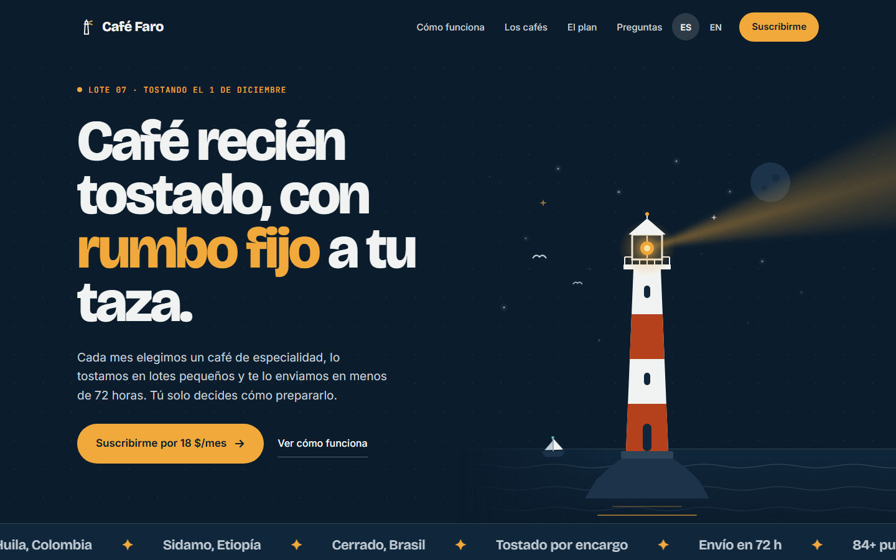
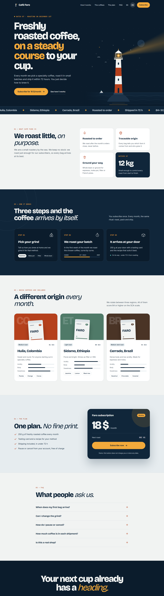

# Café Faro

Landing page de una marca ficticia de café de especialidad con suscripción mensual. Es una pieza de portfolio: una sola página, una sola acción y ningún cobro real.

**Demo:** <https://cafe-faro.pages.dev> · versiones `/es/` y `/en/`



<details>
<summary>Ver la página completa (versión en inglés)</summary>



</details>

> Es una demo: el botón de suscripción no cobra nada ni guarda datos.

## Qué demuestra

- **Sistema de diseño propio:** tokens de marca en `@theme` de Tailwind, tipografía y paleta coherentes.
- **Ilustración solo con CSS y SVG:** el faro, el mar, las estrellas, el haz de luz y las bolsas de café no usan imágenes.
- **Cero JavaScript propio en el cliente:** las animaciones son CSS y `prefers-reduced-motion` las desactiva todas.
- **i18n real:** rutas `/es/` y `/en/` con textos nativos en cada idioma, no traducidos de forma literal.
- **SEO:** canonical, `hreflang`, Open Graph y Twitter por idioma, `sitemap.xml` y `robots.txt`.
- **Rendimiento y accesibilidad:** fuentes autoalojadas, CSS en línea, contraste AA y objetivos táctiles de 44 px.

## Decisiones técnicas

| Decisión | Motivo |
| --- | --- |
| **Astro con salida estática** | La página no necesita interactividad: se entrega HTML y CSS ya generados. |
| **TypeScript estricto** | Los textos de cada idioma se validan con `satisfies`, así que una clave que falte en `en.ts` rompe `pnpm check`. |
| **Tailwind CSS v4** (`@tailwindcss/vite`) | Los tokens viven en un único sitio, `src/styles/global.css`. |
| **Fuentes con Fontsource** | Se sirven desde el propio dominio, sin depender de Google Fonts, y solo con el subconjunto latino. |
| **Olas con `transform`** | Animar `background-position-x` repinta en cada fotograma. Con `transform` la animación pasa a la composición y mejora el rendimiento en móvil. |
| **Sitemap escrito a mano** | Son dos URLs: no compensa añadir una dependencia. |
| **`/` → `/es/` con `public/_redirects`** | Redirección 301 en Cloudflare Pages, sin JS ni lógica en servidor. |

## Estructura

```
src/
├── components/      una pieza por sección (más la escena del faro)
├── data/            cafés, plan, anclas y datos del sitio
├── i18n/            es.ts, en.ts e índice con el tipado
├── layouts/         BaseLayout.astro (metadatos, SEO, cabecera)
├── pages/           index.astro (redirección) y [lang]/index.astro
└── styles/          global.css (tokens y animaciones)
public/              favicon, imagen OG, robots.txt, sitemap.xml, _redirects
```

## Cómo ejecutarlo

Requisitos: Node 22 y [pnpm](https://pnpm.io).

```bash
pnpm install
pnpm dev        # servidor local en http://localhost:4321
pnpm check      # astro check (TypeScript y plantillas)
pnpm build      # genera dist/
pnpm preview    # sirve dist/ para probar la versión final
```

## Despliegue

Cloudflare Pages conectado a este repositorio: cada push a `main` genera un despliegue. La versión de Node se fija en `.node-version`.

## Autoría

Diseño y desarrollo de [GenthimDeV](https://github.com/GenthimDeV). Café Faro es una marca ficticia; cualquier parecido con una real es casual.
